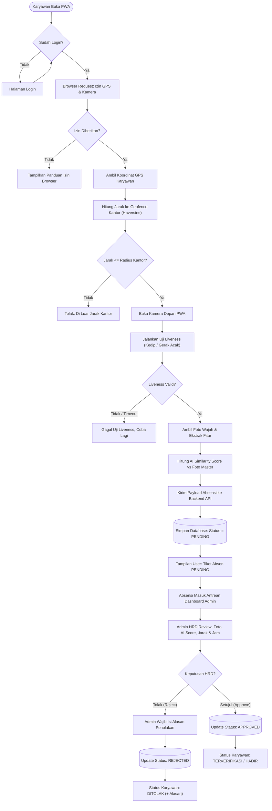

# Product Requirements Document (PRD)
## Sistem Absensi Online Berbasis Geolokasi & Deteksi Wajah (PWA)

---

### Informasi Dokumen
* **Nama Proyek:** Sistem Absensi Karyawan PWA (Geolokasi & Liveness Face Recognition)
* **Versi:** 1.0.0
* **Status:** Ready for Development / Approved
* **Tanggal Penyusunan:** 17 November 2026
* **Penyusun:** JacxBot (Principal PM & Lead System Architect)
* **Target Platform:** Progressive Web App (PWA) - Mobile & Desktop Browser

---

## 1. Ringkasan Eksekutif & Latar Belakang

### 1.1 Masalah Bisnis
Sistem pencatatan kehadiran konvensional (seperti mesin sidik jari fisik atau pengisian form manual) memiliki sejumlah kendala:
1. **Antrean Fisik:** Menumpuknya antrean karyawan pada jam sibuk di dekat mesin absensi.
2. **Kecurangan Kehadiran (*Buddy Punching*):** Titip absen melalui rekan kerja atau manipulasi posisi GPS saat absensi online sederhana.
3. **Fleksibilitas Shift Kerja:** Kebutuhan operasional kantor dengan sistem kerja bergilir (Pagi, Siang, Malam) yang jam kerjanya dinamis dan perlu diatur secara mandiri oleh tim HRD.
4. **Kebutuhan Kontrol HRD Penuh:** Manajemen mewajibkan setiap data absensi harian diverifikasi dan disetujui (*Manual Approval*) oleh HRD sebelum status kehadiran dianggap sah.

### 1.2 Solusi
Membangun aplikasi web berbasis **Progressive Web App (PWA)** yang dapat diakses langsung melalui browser smartphone tanpa instalasi toko aplikasi (Play Store/App Store). Sistem mengombinasikan:
* **Validasi Geolokasi Presisi (Geofence):** Mengunci koordinat karyawan hanya dalam radius kantor yang ditentukan.
* **Deteksi Wajah 1:1 + Liveness Test:** Pengujian kedipan/senyuman acak untuk mencegah *photo spoofing* dan pencocokan AI dengan foto master profil karyawan.
* **Antrean Persetujuan HRD (*Approval Queue*):** Seluruh data absensi masuk dalam status `PENDING` dan wajib diaudit serta di-*approve*/*reject* oleh Admin HRD.
* **Konfigurasi Shift Dinamis:** Admin HRD bebas membuat, mengedit, dan menetapkan jam kerja shift secara fleksibel.

---

## 2. Alur Kerja Aplikasi di Sisi Pengguna (User Workflow Detail)

Alur kerja karyawan (*User*) dirancang *mobile-first* dengan langkah-langkah presisi sebagai berikut:

```
[Buka PWA] 
    └──> [Izin Lokasi & Kamera] 
            └──> [Pengecekan Geofence] 
                    └──> [Uji Liveness Wajah] 
                            └──> [Kirim Data Absen] 
                                    └──> [Status: PENDING APPROVAL]
```

### 2.1 Pendaftaran & Profil Wajah Pertama Kali (*Enrollment*)
1. Karyawan login menggunakan NIK / Email dan Kata Sandi sementara yang diberikan HRD.
2. Sistem mendeteksi bahwa karyawan belum memiliki *Face Master Profile*.
3. Karyawan diarahkan ke halaman pendaftaran wajah:
   * Mengambil 3 sampel foto wajah dari sudut lurus dengan pencahayaan cukup.
   * Sistem mengekstraksi *face vector embeddings* dan mengunggah foto master ke penyimpanan aman.
   * Status profil wajah menunggu verifikasi verifikator HRD.

### 2.2 Alur Absensi Masuk (*Check-In*)
1. **Akses Dashboard Karyawan:**
   * Karyawan membuka PWA pada smartphone.
   * Layar menampilkan informasi tanggal hari ini, shift kerja yang aktif, serta sisa waktu sebelum jam masuk shift dimulai.
2. **Inisialisasi Sensor Perangkat (Kamera & GPS):**
   * PWA meminta izin browser untuk mengakses `Geolocation API` dan `MediaDevices.getUserMedia` (Kamera Depan).
   * Jika izin ditolak, sistem menampilkan panduan instruksi cara mengaktifkan izin di pengaturan browser.
3. **Validasi Geofence (Radius Lokasi Kantor):**
   * PWA mengambil titik koordinat GPS (`latitude`, `longitude`, `accuracy`).
   * Sistem menghitung jarak ke titik kantor menggunakan rumus *Haversine Formula*.
   * **Jika jarak > radius kantor:** Tombol absen dinonaktifkan (*disabled*) dan muncul pesan peringatan: *"Anda berada di luar radius kantor (Jarak: X meter. Maksimum: Y meter)"*.
   * **Jika jarak <= radius kantor:** Tombol absen aktif dan kamera otomatis dinyalakan.
4. **Pengujian Keaslian Wajah (*Liveness Detection*):**
   * Pengguna diminta memposisikan wajah di dalam bingkai oval di layar.
   * Sistem memberikan instruksi acak (misal: *"Kedipkan mata Anda"* atau *"Buka mulut sedikit"*).
   * Algoritma mendeteksi pergerakan wajah alami untuk memastikan pengguna bukan mengarahkan kamera ke foto cetak atau layar perangkat lain.
5. **Pengambilan Foto & Ekstraksi Kecocokan (1:1 Face Matching):**
   * Sistem mengambil frame foto terbaik saat liveness terpenuhi.
   * Model AI mencocokkan wajah saat ini dengan *Face Master Profile*.
   * Skor kemiripan (*similarity confidence score*) dihitung (misal: 94.5%).
6. **Pengiriman Data (*Payload Submission*):**
   * Foto dikompresi di sisi browser (< 300 KB).
   * Data dikirim ke backend API: ID User, ID Shift, Koordinat GPS, Foto Selfie, Skor Kemiripan AI, serta *Idempotency Key* untuk mencegah klik ganda.
   * Waktu absensi dicatat menggunakan **Server NTP Timestamp** (bukan jam lokal HP).
7. **Pembaruan Status Awal:**
   * Layar menampilkan notifikasi sukses kirim: *"Absensi Masuk Berhasil Dikirim. Menunggu Persetujuan HRD."*
   * Status tiket absensi berubah menjadi **`PENDING`**.

### 2.3 Alur Absensi Pulang (*Check-Out*)
* Mengikuti prosedur yang identik dengan Check-In (validasi radius kantor + verifikasi wajah).
* Catatan jam pulang diikatkan pada record absensi yang sama di hari/shift tersebut.

### 2.4 Monitoring Tiket & Notifikasi
* Karyawan dapat memantau status absensi di menu **Riwayat Kehadiran**:
  * Tag Kuning: **`PENDING`** (Menunggu review HRD).
  * Tag Hijau: **`APPROVED`** (Diterima resmi, tercatat masuk).
  * Tag Merah: **`REJECTED`** (Ditolak HRD, disertai alasan penolakan dari admin).

---

## 3. Alur Kerja Aplikasi di Sisi Admin HRD (Admin Workflow Detail)

Alur kerja admin difokuskan pada manajemen shift dinamis dan eksekusi antrean persetujuan absensi harian.

### 3.1 Manajemen Pengaturan Kantor & Geofence
1. Admin membuka menu **Master Data > Lokasi Kantor**.
2. Admin menentukan titik pusat kantor pada peta interaktif (Latitude & Longitude).
3. Admin menentukan parameter radius toleransi (misalnya: 50 meter) dan akurasi GPS maksimum yang diterima (misal: akurasi < 20 meter untuk mencegah koordinat kabur).

### 3.2 Manajemen Shift Kerja Dinamis
Admin memiliki kontrol penuh untuk menentukan jam kerja sesuai kebutuhan operasional:
1. Admin membuka menu **Master Data > Pengaturan Shift**.
2. Admin dapat membuat shift baru (misal: Shift Pagi, Shift Siang, Shift Malam) dengan parameter:
   * **Nama Shift:** (Contoh: *"Shift Pagi - Operasional"*).
   * **Jam Masuk:** (Contoh: `07:00`).
   * **Jam Pulang:** (Contoh: `15:00`).
   * **Batas Toleransi Keterlambatan (*Grace Period*):** (Contoh: `15 menit` setelah jam masuk).
   * **Jendela Absen Dibuka:** (Contoh: `60 menit` sebelum jam masuk).
3. Admin menetapkan jadwal shift ke karyawan secara individu atau per divisi.

### 3.3 Dashboard Antrean Persetujuan (*Approval Queue*)
Semua absensi karyawan masuk ke menu **Approval Kehadiran**:
1. **Tampilan Antrean Absensi (Tabel & Kartu Verifikasi):**
   Admin melihat daftar absensi berstatus `PENDING` yang diurutkan berdasarkan waktu submit terbaru.
   Setiap kartu menampilkan informasi komparatif lengkap:
   * **Identitas Karyawan:** Nama, NIK, Divisi, dan Nama Shift.
   * **Komparasi Wajah Berdampingan (*Side-by-side Photo Comparison*):**
     * Foto Master Profil Karyawan vs Foto Selfie Hasil Liveness Hari Ini.
     * Indikator skor kemiripan AI (misal: *"Kecocokan: 92% (Tinggi)"*).
   * **Verifikasi Lokasi:**
     * Koordinat tercatat, jarak dari titik kantor (misal: *"18 meter dari kantor"*), dan link peta mini interaktif.
   * **Waktu Kehadiran:** Jam submit server vs Jam shift (disertai indikator "Tepat Waktu" atau "Terlambat X menit").
2. **Tindakan Persetujuan (*Single Approval*):**
   * **Tombol `Approve`:** Mengubah status menjadi `APPROVED`. Jam kerja karyawan sah dihitung ke dalam sistem payroll.
   * **Tombol `Reject`:** Muncul modal dialog yang **wajib mengisi alasan penolakan** (opsi cepat: *"Wajah tidak cocok"*, *"Di luar radius"*, *"Foto buram"*, atau isi catatan bebas). Status berubah menjadi `REJECTED`.
3. **Persetujuan Massal (*Bulk Approval with Filter*):**
   * Untuk menghemat waktu tanpa mengorbankan keamanan, admin dapat menggunakan filter:
     * *Filter:* Skor wajah >= 90% DAN Jarak <= 30 meter.
   * Admin menyeleksi absensi yang lolos filter, lalu menekan **"Approve Selected"**. Absensi dengan skor anomali tetap diaudit manual satu per satu.

### 3.4 Rekapitulasi & Audit Trail
* **Menu Laporan:** Filter per tanggal, per shift, dan per divisi untuk melihat persentase kehadiran, jumlah keterlambatan, dan daftar penolakan. Ekspor data ke Excel (XLSX) dan PDF.
* **Audit Trail Log:** Mencatat jejak digital setiap aksi (Admin siapa yang menyetujui, tanggal & jam persetujuan, alamat IP admin).

---

## 4. Diagram Alur Sistem (Flowchart)

Diagram alir berikut menggambarkan proses dari saat user membuka PWA hingga keputusan persetujuan diambil oleh Admin HRD:



---

## 5. Entity Relationship Diagram (ERD)

Struktur data dirancang untuk mendukung multi-shift dinamis, profil biometrik wajah, pelacakan geolokasi, dan pencatatan riwayat persetujuan HRD:

```mermaid
erDiagram
    USERS ||--o| FACE_PROFILES : "memiliki"
    USERS ||--o{ USER_SHIFTS : "dijadwalkan"
    SHIFTS ||--o{ USER_SHIFTS : "diterapkan_ke"
    SHIFTS ||--o{ ATTENDANCES : "menjadi_rujukan"
    USERS ||--o{ ATTENDANCES : "melakukan"
    USERS ||--o{ ATTENDANCES : "menyetujui"
    OFFICE_LOCATIONS ||--o{ ATTENDANCES : "lokasi_target"
    USERS ||--o{ AUDIT_LOGS : "mencatat_aktivitas"

    USERS {
        uuid id PK
        string nik UK "Nomor Induk Karyawan"
        string full_name
        string email UK
        string password_hash
        string phone_number
        enum role "EMPLOYEE / HRD_ADMIN / SUPERADMIN"
        boolean is_active
        datetime created_at
        datetime updated_at
    }

    FACE_PROFILES {
        uuid id PK
        uuid user_id FK UK
        string master_photo_url
        jsonb face_embeddings "Vector representasi wajah 128/512 dimensi"
        boolean is_verified
        uuid verified_by FK
        datetime created_at
        datetime updated_at
    }

    OFFICE_LOCATIONS {
        uuid id PK
        string office_name
        decimal latitude
        decimal longitude
        int radius_meters "Contoh: 50 meter"
        int max_gps_accuracy_meters "Contoh: 20 meter"
        boolean is_active
        datetime created_at
    }

    SHIFTS {
        uuid id PK
        string shift_name "Contoh: Shift Pagi, Siang, Malam"
        time start_time "Contoh: 08:00:00"
        time end_time "Contoh: 17:00:00"
        int late_tolerance_minutes "Toleransi keterlambatan (Menit)"
        int open_before_minutes "Jendela absen buka sebelum jam masuk"
        boolean is_active
        datetime created_at
        datetime updated_at
    }

    USER_SHIFTS {
        uuid id PK
        uuid user_id FK
        uuid shift_id FK
        date work_date "Tanggal berlakunya shift"
        datetime created_at
    }

    ATTENDANCES {
        uuid id PK
        uuid user_id FK
        uuid shift_id FK
        uuid office_location_id FK
        date attendance_date
        datetime check_in_time "Server timestamp"
        decimal check_in_lat
        decimal check_in_lng
        decimal check_in_distance_meters
        string check_in_photo_url
        decimal check_in_face_score "Skor kemiripan AI (0 - 100%)"
        boolean check_in_liveness_verified
        datetime check_out_time "Server timestamp"
        decimal check_out_lat
        decimal check_out_lng
        decimal check_out_distance_meters
        string check_out_photo_url
        decimal check_out_face_score
        boolean check_out_liveness_verified
        enum status "PENDING / APPROVED / REJECTED"
        uuid approved_by FK "ID Admin yang memproses"
        datetime approved_at
        text rejection_reason "Alasan jika ditolak"
        string idempotency_key UK
        datetime created_at
        datetime updated_at
    }

    AUDIT_LOGS {
        uuid id PK
        uuid user_id FK "Pelaku aksi"
        string action_name "Contoh: APPROVE_ATTENDANCE / CREATE_SHIFT"
        string target_entity "Nama tabel terkait"
        uuid target_id "ID record terkait"
        jsonb old_values
        jsonb new_values
        string ip_address
        string user_agent
        datetime created_at
    }
```

---

## 6. Kebutuhan Fungsional & Non-Fungsional

### 6.1 Kebutuhan Fungsional (Functional Requirements)
* **FR-01 (PWA Compatibility):** Aplikasi web harus memiliki Service Worker dan Web App Manifest (`manifest.json`) agar dapat diinstal (*Add to Home Screen*) dan memiliki tampilan layar penuh (*standalone*).
* **FR-02 (Hardware Sensor Integration):** PWA wajib mengakses GPS akurat (`enableHighAccuracy: true`) dan streaming kamera depan resolusi minimal 720p.
* **FR-03 (Liveness Detection Engine):** Sistem mendeteksi respons kedipan atau gerakan kepala acak secara real-time di sisi browser (menggunakan WebAssembly / TensorFlow.js atau model visi ringan) sebelum foto di-capture.
* **FR-04 (1:1 Face Verification):** Sistem menghitung jarak euklidian / cosine similarity antara vektor wajah saat ini dengan foto master; menghasilkan persentase skor kemiripan.
* **FR-05 (Geofence Calculation):** Menggunakan kalkulasi jarak Haversine di backend untuk memvalidasi posisi karyawan terhadap koordinat kantor.
* **FR-06 (Dynamic Shift Engine):** Admin HRD dapat menambah, mengubah, mengaktifkan/menonaktifkan shift kerja (jam masuk, jam pulang, toleransi keterlambatan) kapan saja melalui antarmuka web.
* **FR-07 (Approval Queue & Bulk Action):** Antarmuka dashboard admin untuk meninjau data komparasi foto wajah dan koordinat, lengkap dengan tombol Approve, Reject (wajib alasan), dan Bulk Approve berdasarkan filter parameter.
* **FR-08 (Reporting & Export):** Fitur unduh rekap absensi harian dan bulanan dalam format XLSX dan PDF.

### 6.2 Kebutuhan Non-Fungsional (Non-Functional Requirements)
* **NFR-01 (Integritas Waktu - Server NTP):** Jam absensi wajib menggunakan waktu server backend yang tersinkronisasi NTP, mengabaikan jam lokal perangkat browser.
* **NFR-02 (Performa & Kompresi):** Waktu respons verifikasi wajah tidak boleh melebihi 2 detik. Gambar selfie wajib dikompresi di browser menjadi < 300 KB sebelum diunggah.
* **NFR-03 (Keamanan Biometrik & Privasi Data):** Foto wajah disimpan pada cloud storage privat (*presigned URL* berdurasi terbatas). Vektor biometrik dienkripsi dalam database sesuai prinsip perlindungan data pribadi (UU PDP).
* **NFR-04 (Keandalan Jaringan):** PWA harus menangani kondisi jaringan terputus (*offline/weak network*) dengan pesan yang jelas tanpa menyebabkan data duplikat (*Idempotent API*).

---

## 7. User Stories & Acceptance Criteria (Gherkin Format)

### US-01: Absensi Masuk dengan Liveness dan Geofence
* **Sebagai** Karyawan,  
* **Saya ingin** melakukan absen masuk melalui browser HP menggunakan verifikasi wajah dan GPS,  
* **Agar** kehadiran saya tercatat akurat dan siap diaudit oleh HRD.

```gherkin
Scenario: Absensi masuk berhasil dan masuk antrean approval
  Given Karyawan telah login di PWA dan berada di dalam radius 50 meter kantor
  And Karyawan memiliki Face Master Profile yang terverifikasi
  When Karyawan membuka menu absen masuk dan berhasil menyelesaikan tantangan liveness
  And Skor kemiripan wajah AI melebihi ambang batas 80%
  Then Sistem mencatat koordinat, waktu server, dan foto selfie
  And Status absensi berubah menjadi "PENDING"
  And Karyawan melihat notifikasi "Absensi Masuk Terkirim, Menunggu Persetujuan HRD"

Scenario: Karyawan mencoba absen di luar radius geofence
  Given Karyawan berada 150 meter dari titik kantor
  When Karyawan membuka halaman absensi
  Then Sistem menampilkan pesan "Anda berada di luar radius kantor"
  And Tombol kamera dan absen dinonaktifkan
```

### US-02: HRD Melakukan Review dan Persetujuan Absensi
* **Sebagai** Admin HRD,  
* **Saya ingin** memeriksa foto komparasi wajah dan lokasi absensi karyawan,  
* **Agar** saya dapat menyetujui kehadiran yang valid dan menolak yang tidak sesuai aturan.

```gherkin
Scenario: Admin menyetujui absensi yang valid
  Given Terdapat daftar absensi berstatus "PENDING" di dashboard HRD
  When Admin membuka detail tiket absensi dan melihat foto selfie cocok dengan foto master
  And Jarak lokasi karyawan berada di dalam radius kantor
  And Admin menekan tombol "Approve"
  Then Status tiket berubah menjadi "APPROVED"
  And Waktu absensi masuk secara sah ke rekapitulasi kehadiran

Scenario: Admin menolak absensi karena foto tidak cocok
  Given Admin menemukan skor kemiripan wajah rendah atau foto buram
  When Admin menekan tombol "Reject"
  And Admin mengisi alasan penolakan "Wajah tidak jelas / foto orang lain"
  Then Status tiket berubah menjadi "REJECTED"
  And Karyawan menerima pembaruan status beserta alasan penolakan di riwayat kehadiran
```

---

## 8. Matriks Mitigasi Celah Bug, Fraud & Edge Cases

| No | Potensi Celah / Kasus Ekstrem | Risiko Masalah | Solusi & Penanganan Teknis |
| :--- | :--- | :--- | :--- |
| **1** | **Fake GPS / DevTools Location Override** | Karyawan memanipulasi koordinat agar terlihat di kantor. | Evaluasi `geolocation.accuracy` (jika akurasi tidak realistis < 1m atau > 50m, beri peringatan). Validasi konsistensi IP Address provider dengan subnet Wi-Fi kantor jika tersedia. |
| **2** | **Photo Attack (Menodongkan foto cetak / HP lain)** | Titip absen dengan foto rekan kerja. | Wajib lulus uji *Liveness Detection* interaktif (kedipan mata acak / pergerakan) sebelum kamera mengambil frame foto. |
| **3** | **Time Tampering (Memundurkan jam di HP)** | Menghindari status terlambat dengan memutar jam HP. | Waktu submit absensi **mutlak** diambil dari Server Timestamp di Backend (menggunakan sinkronisasi NTP), waktu lokal HP diabaikan. |
| **4** | **Double Click / Lemot Jaringan (Race Condition)** | Karyawan menekan tombol absen berkali-kali sehingga data tersimpan ganda. | Implementasi *Idempotency Key* berbasis UUID pada request POST. Tombol langsung di-disable dan diberi indikator loading setelah klik pertama. |
| **5** | **Izin Kamera / GPS Ditolak Pengguna** | PWA macet tanpa pesan jelas jika user menolak izin browser. | Handler khusus untuk `NotAllowedError` dan `PermissionDenied`. Tampilkan modal panduan visual langkah-langkah me-reset izin di browser. |
| **6** | **Peralihan Jam Shift Malam (Melewati Tengah Malam)** | Shift malam masuk jam 22.00 dan pulang jam 06.00 besoknya. | Pengikatan record absensi berbasis `shift_id` dan `work_date` jadwal, bukan berdasarkan tanggal kalender saat check-out. |

---

## 9. Desain API & Data Contract Ringkas

```text
POST /api/v1/auth/login
Request:  { "nik": "100234", "password": "secure_password" }
Response: { "token": "jwt_token", "user": { "id": "uuid", "role": "EMPLOYEE", "name": "Budi" } }

POST /api/v1/attendance/check-in
Headers:  Authorization: Bearer <token>, X-Idempotency-Key: <uuid>
Request (Multipart/JSON): 
          {
            "shift_id": "uuid_shift_pagi",
            "latitude": -6.2088,
            "longitude": 106.8456,
            "accuracy": 12.5,
            "liveness_passed": true,
            "photo_base64": "data:image/jpeg;base64,..."
          }
Response: { "status": "success", "data": { "attendance_id": "uuid", "state": "PENDING" } }

GET /api/v1/admin/attendances/pending?date=2026-11-17&page=1&limit=20
Response: { 
            "total": 45, 
            "items": [
              {
                "id": "uuid_absen",
                "user_name": "Budi",
                "shift_name": "Shift Pagi",
                "check_in_time": "2026-11-17T07:55:12Z",
                "distance_meters": 14.2,
                "face_score": 93.4,
                "photo_selfie_url": "https://storage.../selfie.jpg",
                "photo_master_url": "https://storage.../master.jpg"
              }
            ]
          }

POST /api/v1/admin/attendances/:id/decision
Request:  { "action": "APPROVE" } ATAU { "action": "REJECT", "rejection_reason": "Wajah tidak jelas" }
Response: { "status": "success", "message": "Attendance record updated to APPROVED" }

POST /api/v1/admin/shifts
Request:  { "shift_name": "Shift Malam", "start_time": "22:00:00", "end_time": "06:00:00", "late_tolerance_minutes": 10 }
Response: { "status": "success", "data": { "id": "uuid_shift_baru" } }
```

---

## 10. Metrik Keberhasilan (Success Metrics / KPI)

1. **Tingkat Akurasi Verifikasi Wajah (False Acceptance Rate / FAR):** FAR < 0.1% (tidak ada orang lain yang berhasil lolos menggunakan identitas orang lain).
2. **Efisiensi Waktu Approval HRD:** Rata-rata waktu admin HRD menyelesaikan approval harian < 15 menit per 100 karyawan dengan bantuan fitur komparasi visual & *bulk filter*.
3. **Waktu Proses Absensi Pengguna (*Time-to-Check-In*):** Dari buka kamera hingga submit berhasil diselesaikan dalam waktu < 5 detik.
4. **Tingkat Keberhasilan PWA:** Kompatibilitas 99% pada Chrome (Android) dan Safari (iOS).
